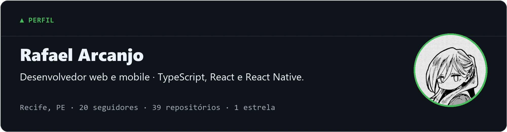
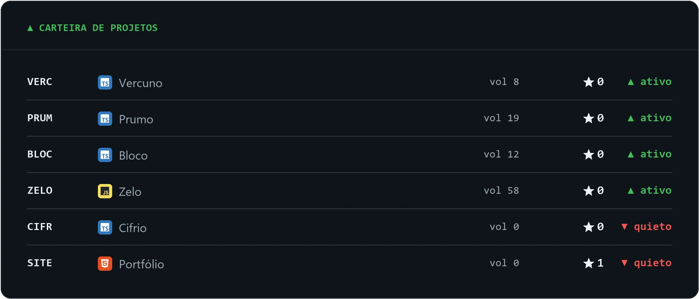
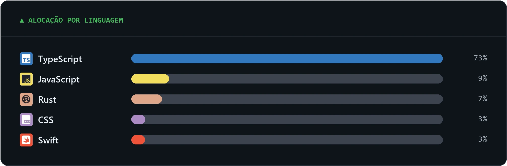
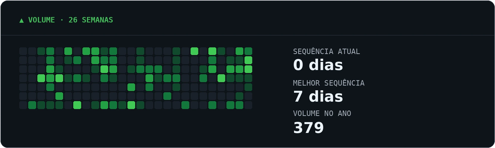
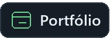
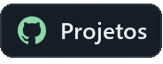
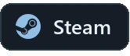
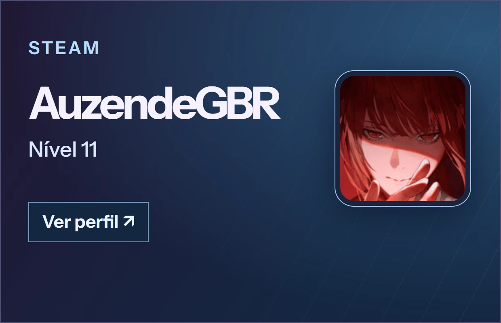

  <picture>
    <source media="(max-width: 640px)" srcset="./assets/stock-ticker/mobile.webp">
    
  </picture>

A cotação visual usa US$ 0,30 por contribuição nos últimos 30 dias. As barras mostram as contribuições por semana. O gráfico e o mapa têm atualização automática programada a cada 30 minutos.

  <picture>
    <source media="(max-width: 640px)" srcset="./assets/stock-ticker/perfil-mobile.webp">
    
  </picture>

  <picture>
    <source media="(max-width: 640px)" srcset="./assets/stock-ticker/carteira-mobile.webp">
    
  </picture>

[Vercuno](https://github.com/RafaelADSdev/Vercuno) · [Prumo](https://github.com/RafaelADSdev/prumo) · [Bloco](https://github.com/RafaelADSdev/notionREA) · [Zelo](https://github.com/RafaelADSdev/Zelo) · [Cifrio](https://github.com/RafaelADSdev/Cifrio) · [Portfólio](https://github.com/RafaelADSdev/Site-curriculo-)

  <picture>
    <source media="(max-width: 640px)" srcset="./assets/stock-ticker/linguagens-mobile.webp">
    
  </picture>

  <picture>
    <source media="(max-width: 640px)" srcset="./assets/stock-ticker/volume-mobile.webp">
    
  </picture>

  &nbsp;
  &nbsp;

**Mobile**  
   

Tecnologias e ferramentas

**Web**  
            

**Mobile**  
 

**Back-end e dados**  
       

**Integrações e conteúdo**  
   

**Testes e entrega**  
        

Sobre mim

Sou **Rafael Arcanjo**, desenvolvedor web e mobile em Recife, PE. Crio sites, aplicativos e sistemas com TypeScript, React, Next.js e React Native.

Sou formado em **Análise e Desenvolvimento de Sistemas** pelo **Senac PE**. Na **HubON / Hub Nogueira**, trabalhei com sistemas internos, integrações com CRM e automação de processos.

Estou aberto a novos projetos e oportunidades.

Sobre os projetos

- **[Vercuno](https://github.com/RafaelADSdev/Vercuno)** apresenta serviços e cases de landing pages, sites institucionais e sistemas web.
- **[Prumo](https://github.com/RafaelADSdev/prumo)** organiza receitas, despesas, serviços e veículos em um painel com opção de uso local.
- **[Bloco](https://github.com/RafaelADSdev/notionREA)** oferece um editor de notas em blocos com armazenamento no navegador. [Testar o Bloco](https://bloco-jet.vercel.app/)
- **[Zelo](https://github.com/RafaelADSdev/Zelo)** reúne atendimento pelo WhatsApp, assistentes de IA e revisão de campanhas.
- **[Cifrio](https://github.com/RafaelADSdev/Cifrio)** é um aplicativo de finanças pessoais feito com React Native e Expo, com exportação para iOS e Android.
- **[Portfólio](https://github.com/RafaelADSdev/Site-curriculo-)** reúne formação, experiência e projetos em português e inglês.

Capturas dos projetos

  
  
  

Mais projetos

- **[Jairo Rocha Imóveis](https://github.com/RafaelADSdev/Jairo-RochaAPP)** é um protótipo Android de catálogo imobiliário com dados do Supabase. `React Native` · `Expo Router` · `Supabase`
- **[Dashboard Stüpp](https://github.com/RafaelADSdev/Dashboard-St-pp)** acompanha funis de vendas e roletas de distribuição, com transferência de leads em um quadro Kanban. `Next.js` · `Supabase` · `Bitrix24`
- **[Náutica Engenharia](https://github.com/RafaelADSdev/Nautica-engenharia)** reúne páginas de serviços, cases e um painel editorial. `Astro` · `TypeScript` · `Sanity`

Animação de contribuições, estatísticas e jogos

<picture>
  <source media="(prefers-color-scheme: dark)" srcset="https://raw.githubusercontent.com/RafaelADSdev/RafaelADSdev/output/github-contribution-grid-snake-dark.svg">
  
</picture>

Estatísticas, sequência e calendário 3D

  
  

  

Jogos e experimentos

  
  

**Runeterra · Arena offline** é um projeto de fã com campanha em 10 regiões, editor de decks e duelos contra o bot. `JavaScript` · `WebGL` · `PWA` · [Jogar no navegador](https://lorremake.vercel.app/) · [Ver código](https://github.com/RafaelADSdev/Lor-remake)

Referência visual · <a href="https://www.gitskins.com/templates/stock-ticker">Stock Ticker do GitSkins</a>
