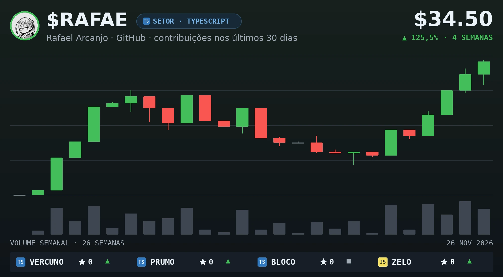
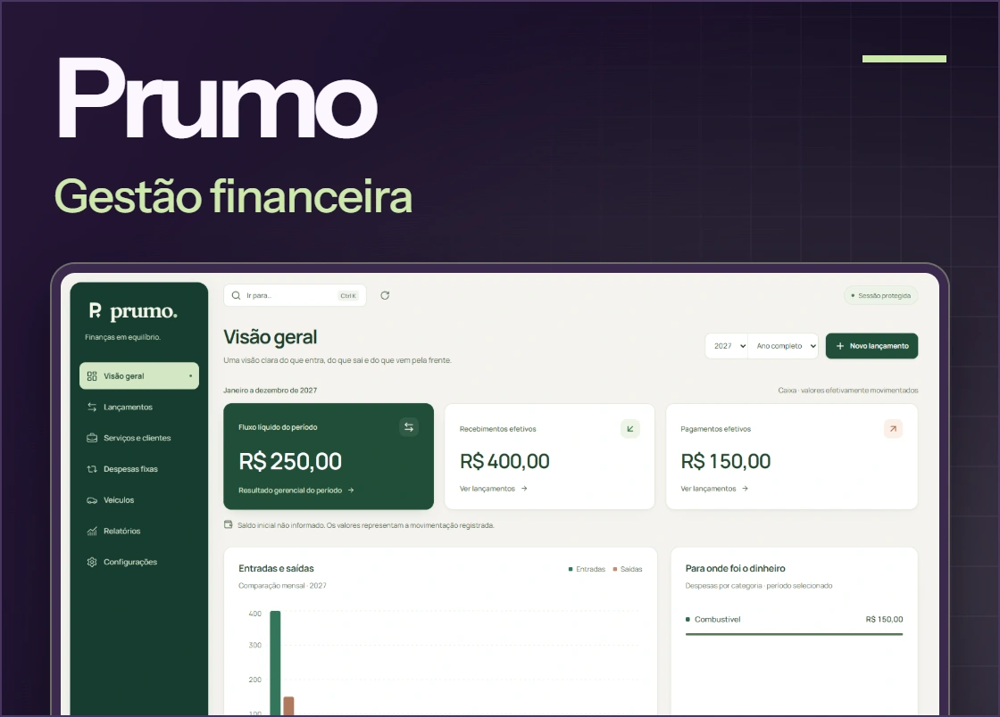
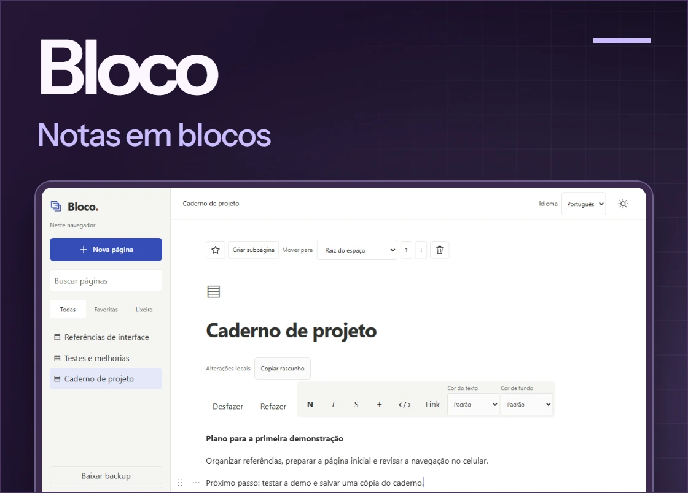
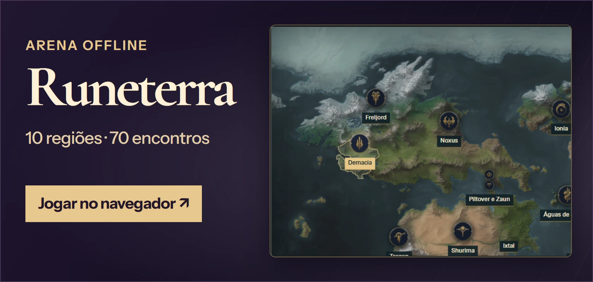

<picture>
  <source media="(max-width: 640px)" srcset="./assets/stock-ticker/mobile.webp">
  
</picture>

As velas mostram a variação semanal do total móvel de 30 dias. As barras mostram as contribuições de cada semana.

  <a href="https://rafaeladsdev.com/">Portfólio</a> ·
  <a href="https://www.linkedin.com/in/rafaeladsdev/">LinkedIn</a> ·
  <a href="#carteira-de-projetos">Projetos</a> ·
  <a href="https://steamcommunity.com/id/AuzendeGBR/">Steam</a>

## Perfil

Sou **Rafael Arcanjo**, desenvolvedor web e mobile em Recife, PE. Crio sites, aplicativos e sistemas com TypeScript, React, Next.js e React Native.

Sou formado em **Análise e Desenvolvimento de Sistemas** pelo **Senac PE**. Na **HubON / Hub Nogueira**, trabalhei com sistemas internos, integrações com CRM e automação de processos.

Estou aberto a novos projetos e oportunidades.

## Carteira de projetos

| Código | Projeto | O que faz |
| :--- | :--- | :--- |
| `VERC` | [Vercuno](https://github.com/RafaelADSdev/Vercuno) | Site de serviços e portfólio de landing pages, sites institucionais e sistemas web. `Next.js` · `TypeScript` |
| `PRUM` | [Prumo](https://github.com/RafaelADSdev/prumo) | Painel para receitas, despesas, serviços e veículos, com opção de uso local. `Next.js` · `Prisma` · `SQLite` |
| `BLOC` | [Bloco](https://github.com/RafaelADSdev/notionREA) | Caderno com editor em blocos e dados salvos no navegador. `Next.js` · `Tiptap` · `IndexedDB` · [Demo](https://bloco-jet.vercel.app/) |
| `ZELO` | [Zelo](https://github.com/RafaelADSdev/Zelo) | Atendimento pelo WhatsApp, assistentes de IA e revisão de campanhas antes do envio. `Node.js` · `Supabase` · `WhatsApp Cloud API` |

Capturas dos projetos

  
  
  

Mais projetos

- **[Jairo Rocha Imóveis](https://github.com/RafaelADSdev/Jairo-RochaAPP)** é um protótipo Android de catálogo imobiliário com dados do Supabase. `React Native` · `Expo Router` · `Supabase`
- **[Dashboard Stüpp](https://github.com/RafaelADSdev/Dashboard-St-pp)** acompanha funis de vendas e roletas de distribuição, com transferência de leads em um quadro Kanban. `Next.js` · `Supabase` · `Bitrix24`
- **[Náutica Engenharia](https://github.com/RafaelADSdev/Nautica-engenharia)** reúne páginas de serviços, cases e um painel editorial. `Astro` · `TypeScript` · `Sanity`

## Tecnologias

| Área | Ferramentas |
| :--- | :--- |
| Web | `TypeScript` · `JavaScript` · `React` · `Next.js` · `Astro` · `Tailwind CSS` · `Three.js` |
| Mobile | `React Native` · `Expo` |
| Back-end e dados | `Node.js` · `Supabase` · `PostgreSQL` · `Prisma` · `SQLite` · `Zod` · `DBeaver` |
| Integrações e conteúdo | `Bitrix24` · `n8n` · `Sanity` |
| Testes e entrega | `Vitest` · `Playwright` · `Vercel` · `GitHub Actions` |

## Contribuições

<picture>
  <source media="(prefers-color-scheme: dark)" srcset="https://raw.githubusercontent.com/RafaelADSdev/RafaelADSdev/output/github-contribution-grid-snake-dark.svg">
  
</picture>

Estatísticas, sequência e calendário 3D

  
  

  

Jogos e experimentos

  
  

**Runeterra · Arena offline** é um projeto de fã com campanha em 10 regiões, editor de decks e duelos contra o bot. `JavaScript` · `WebGL` · `PWA` · [Jogar no navegador](https://lorremake.vercel.app/) · [Ver código](https://github.com/RafaelADSdev/Lor-remake)

Referência visual · <a href="https://www.gitskins.com/templates/stock-ticker">Stock Ticker do GitSkins</a>
